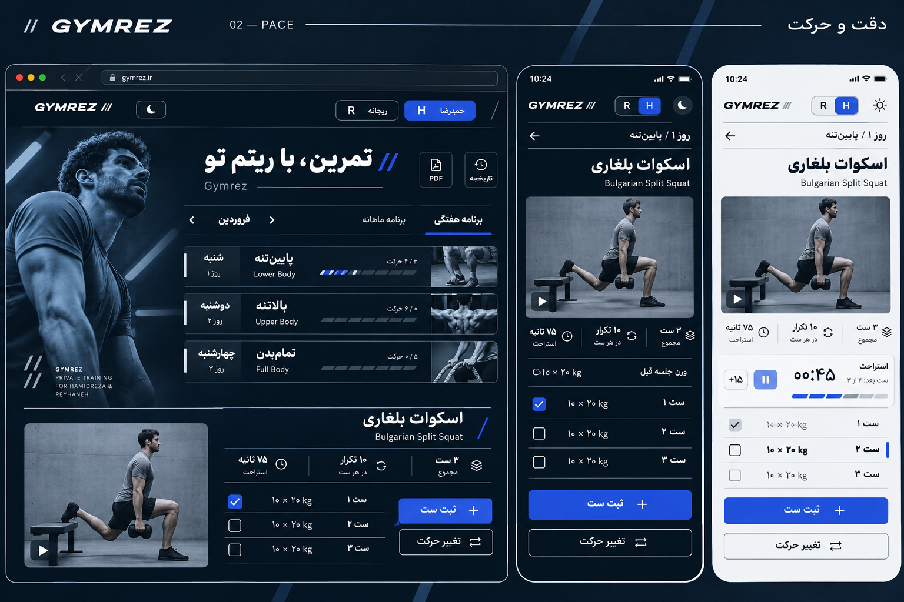
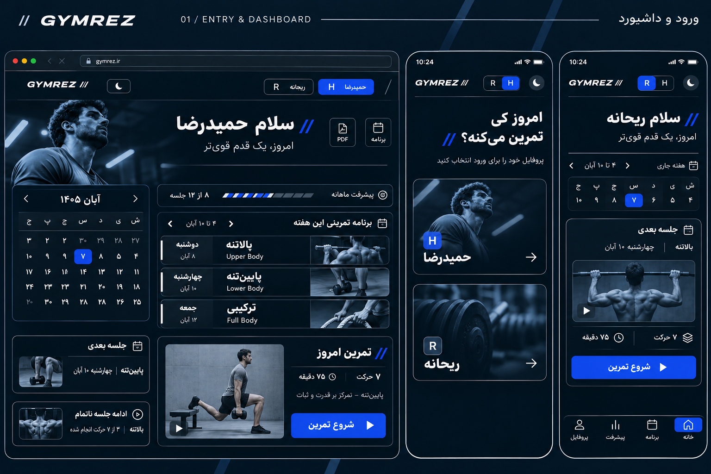
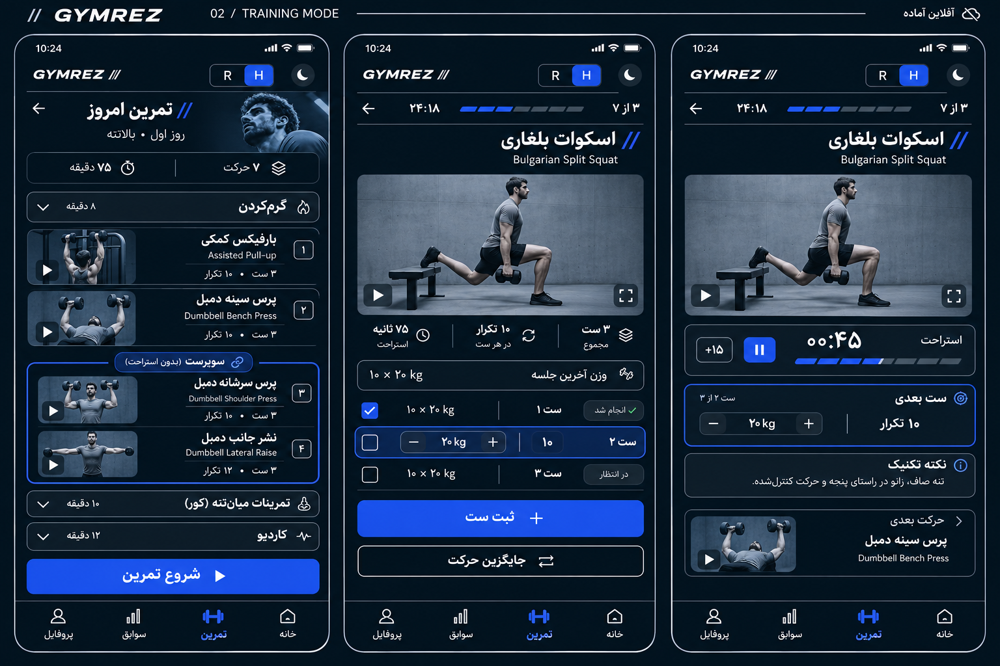
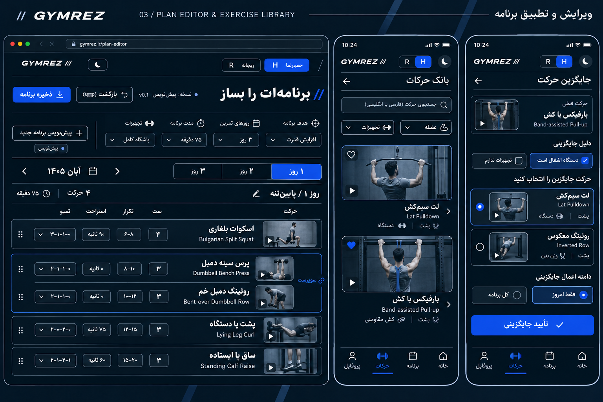
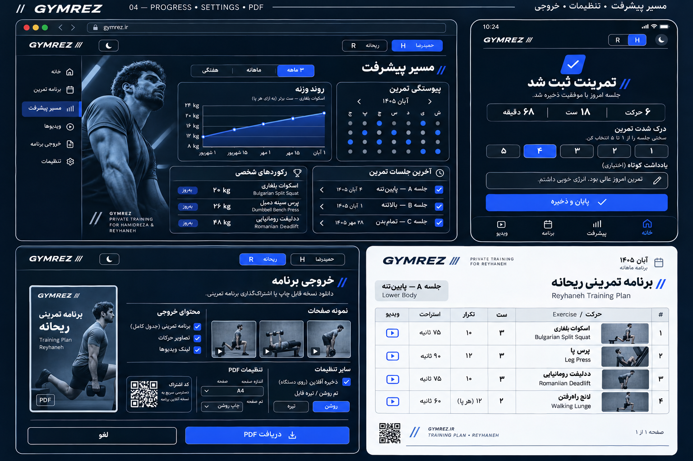
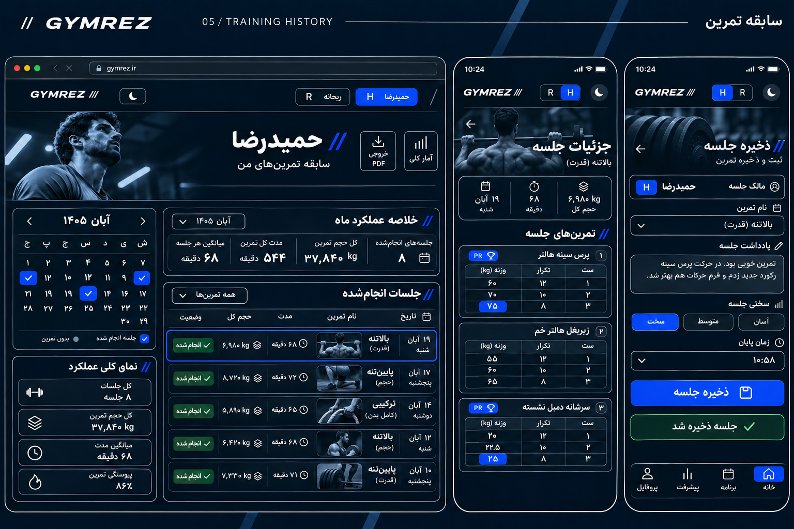
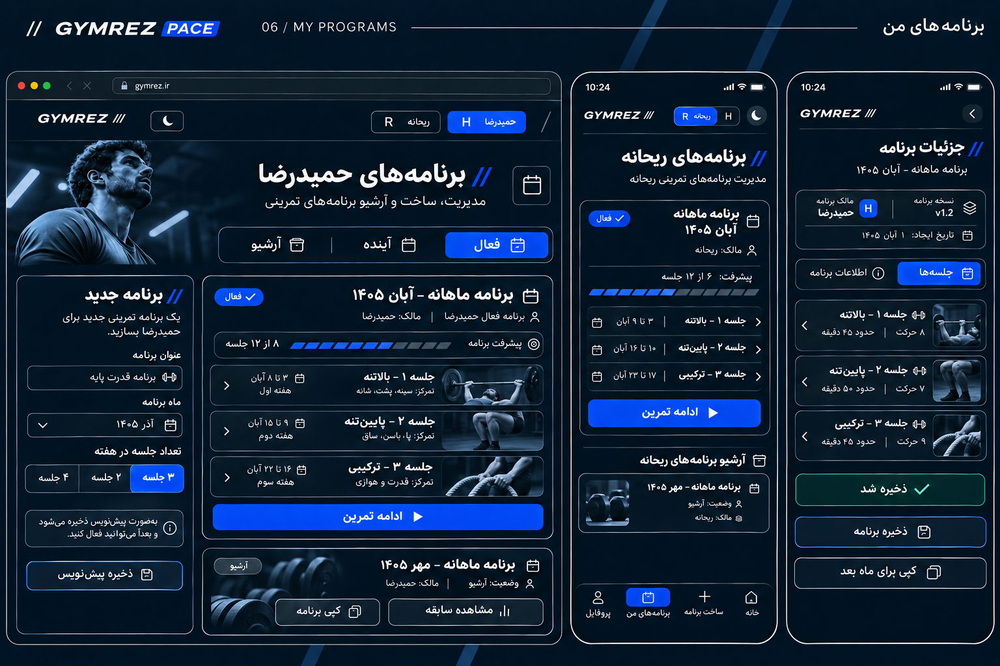
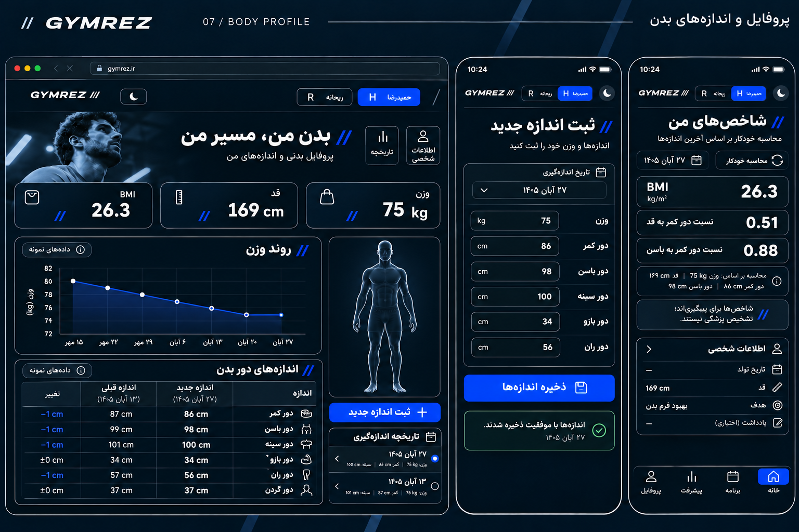

# Gymrez — PACE Mockups

موکاپ‌های منتخب وب‌سایت تمرین اختصاصی حمیدرضا و ریحانه با هویت سرمه‌ای و آبی PACE.

این تصاویر مرجع طراحی هستند؛ متن‌ها، داده‌ها، نمودارها و حرکت‌ها نمونه نمایشی‌اند. ویدئو، انیمیشن، لینک و QR داخل تصاویر عملکرد واقعی ندارند.

## طرح اصلی و هویت بصری

## ورود و داشبورد شخصی

## اجرای تمرین و استراحت

## ویرایش برنامه و بانک حرکات

## پیشرفت، تنظیمات و خروجی PDF

## سابقه تمرین و ذخیره جلسه

## برنامه‌ها و آرشیو هر پروفایل

## اطلاعات شخصی، اندازه‌های بدن و شاخص‌ها

مشخصات رفتار و ذخیره‌سازی پیشنهادی: [FEATURES.md](./FEATURES.md).

> این ریپو فعلاً مرجع طراحی است و اپ اجرایی یا پایگاه داده ندارد. نمایش «ذخیره شد» در تصاویر، نمونه طراحی وضعیت موفقیت است.
